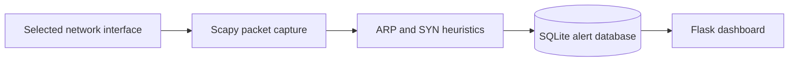

# Network Intrusion Detection System (IDS)

A Python and Scapy network-monitoring prototype with a Flask dashboard. It captures packets on a selected interface, applies simple ARP and TCP SYN heuristics, and stores resulting alerts in a local SQLite database. This is an educational lab project, not a production IDS or a substitute for network security controls.

## Detection and data flow



- **ARP spoofing indicator:** tracks ARP replies and alerts when an IP previously observed during the current monitoring session appears with a different MAC address. A change involving the detected default gateway is assigned higher severity.
- **ARP flood heuristic:** counts ARP packets by source IP over a sliding window. The default is more than 30 packets in 5 seconds.
- **TCP SYN flood heuristic:** counts SYN packets without ACK by source IP. The dashboard defaults to more than 20 such packets in 10 seconds; a 30-second per-source cooldown limits repeated alerts.
- **Dashboard:** authenticated views display recent alerts and packet counters; the admin view can start/stop monitoring and adjust the in-memory thresholds.
- **Persistence:** SQLite stores users and alerts locally. Detection state and dashboard counters are held in process memory.

These are threshold-based indicators, not protocol-aware confirmation of an attack. They do not verify whether a TCP handshake completes or establish that a source is malicious.

## Technology

Python, Flask, Flask-Login, Flask-SQLAlchemy, Scapy, SQLite, HTML, and CSS.

## Local setup

Use an isolated Linux VM or another dedicated lab machine with Python and packet-capture support. On Linux, Scapy capture and packet transmission generally require elevated network privileges or appropriate packet-capture capabilities.

```bash
git clone https://github.com/wejden123cherif/IDS_Project.git
cd IDS_Project
python -m venv .venv
source .venv/bin/activate
python -m pip install --upgrade pip
python -m pip install -r requirements.txt
python app.py
```

On Windows PowerShell, activate the environment with `.venv\Scripts\Activate.ps1`. The application creates its SQLite tables and seeds demo accounts on first startup. The seeded credentials and Flask secret in the source are development defaults: replace them before any shared use, and never expose this app to an untrusted network. The development server runs with Flask debug mode enabled, so do not use it as a public deployment server.

Open `http://127.0.0.1:5000`. Sign in with a locally configured account and use the admin dashboard to choose an interface and start monitoring. Packet capture requires access to a suitable interface; a loopback interface or virtual network may not show the traffic you expect.

## Safe lab use

Packet capture is passive, but the scripts under `simulator/` and `test_packet_generator.py` transmit real ARP or TCP packets and may require elevated privileges. Use them only on an isolated, authorized lab network with disposable hosts that you control. Review each script's target and interface before running it. In particular, `test_packet_generator.py` has a public external address as its default SYN destination; do not run that default. Do not run packet generators against public IPs, shared networks, or third-party systems.

A safe validation setup keeps the IDS sensor and disposable target on a host-only or otherwise isolated virtual network. Confirm the route and destination before sending any traffic. A simulation script may also insert a synthetic alert directly into the local database, so a dashboard entry is not always evidence that the packet detector observed the event.

## Limitations and security posture

- ARP address changes can be legitimate (for example, failover, virtualization, or network reconfiguration) and may trigger false positives. The ARP table is in memory and resets when monitoring starts.
- Fixed per-source thresholds can miss distributed or low-rate activity and can flag benign bursts. IP-based grouping is not reliable attribution.
- The dashboard, authentication defaults, secret handling, and Flask debug configuration are for a local demonstration only. The repository should not be deployed as-is on a public or production network.
- No measured detection accuracy, false-positive rate, or performance benchmark is documented.
- `test_capture.py` and `test_packet_generator.py` are manual packet scripts, not an automated unit-test suite.

## Project scope

This repository demonstrates packet capture, basic traffic heuristics, alert persistence, and a small dashboard. It does not provide hardened account management, a calibrated detection model, high availability, or production incident-response automation.
